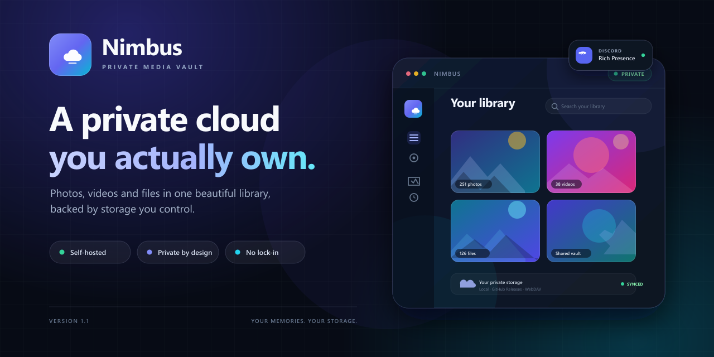
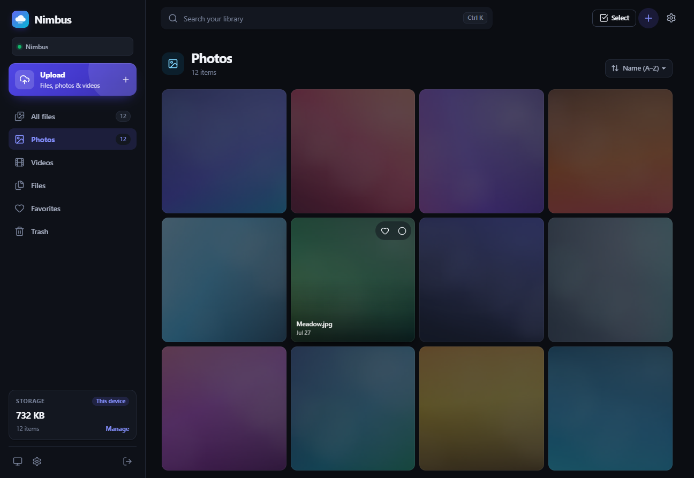

<p align="center">
  
</p>

<h1 align="center">Nimbus</h1>

<p align="center">
  <strong>A private photo, video and file library backed by the cloud you already own.</strong><br>
  Self-hosted. Single-owner. No analytics, no third-party scripts, no vendor lock-in.
</p>

<p align="center">
  <a href="https://github.com/daviizinkk/Nimbus/releases/latest">
    
  </a>
  <a href="#quick-start">
    
  </a>
</p>

<p align="center">
  
  
  
  
</p>

## Download

**Nimbus 1.1.0 for Windows 10/11 x64** is available from the
[Releases page](https://github.com/daviizinkk/Nimbus/releases/latest).

1. Download **Nimbus-Setup-1.1.0.exe**.
2. Run the installer and choose an install folder. The desktop shortcut is optional; the
   Start menu entry is always created.
3. Launch **Nimbus** and complete the first-run setup. Your library stays on this PC unless
   you choose GitHub Releases or WebDAV for originals.

The installer is unsigned, so Windows SmartScreen may ask for confirmation. Choose
**More info → Run anyway** if you trust the download. SHA-256 checksums and release notes are
published with every release. Nimbus does not install an auto-updater; new versions are
installed by downloading the next setup.

Prefer the browser? Nimbus runs anywhere Node.js 24 is available. See
[Quick start](#quick-start) or [Docker](#docker).

## A look inside

<p align="center">
  
</p>

<p align="center">
  <em>The Photos view: a pinned library sidebar, instant tab switching, and a media grid that owns the scroll.</em>
</p>

## Why Nimbus

| Feature | What it means |
| --- | --- |
| **Bring your own storage** | Keep originals on local disk, in a private GitHub Releases repository, or on any WebDAV server. Nimbus never locks your files behind its own cloud. |
| **Built for media** | A Google Photos/Drive-style gallery with full-screen viewing, keyboard navigation, search, favorites, sorting and multi-select actions. |
| **Instant tabs** | Photos, Videos and Files are cached, prefetched and revalidated in the background. Scroll positions are restored per view, and the content grid is the only thing that scrolls. |
| **Fast previews and streaming** | Sharp generates WebP thumbnails. Originals stream with byte ranges, `HEAD`, ETags and cache-friendly headers, so large videos seek without loading the whole file. |
| **Large files on GitHub** | Files above 1 GiB are split into 1 GiB release assets and stitched back together transparently for previews, downloads and range requests. |
| **Smart encrypted cache** | Remote files are cached after first access, encrypted at rest with AES-256-GCM, limited by size, and evicted least-recently-used. Pin files for offline use. |
| **Durable uploads** | Uploads are staged to disk and stored by a background queue with retries. Once the browser finishes sending, the upload continues even if the tab closes. |
| **Private by default** | scrypt passwords, DB-backed sessions, HttpOnly cookies, a CSRF header on mutations, a strict CSP, and encrypted provider credentials. No telemetry. |
| **Windows app included** | The same server and UI in a frameless Electron window, with Discord Rich Presence, offline password reset, folder/log shortcuts, diagnostics and a cleanup-aware uninstaller. |
| **One process, one database** | Node 24, Fastify 5 and built-in `node:sqlite`. No Redis, no Postgres, no separate worker, no build tooling in production. |

## What's new in 1.1

- **Discord Rich Presence, ready out of the box** — a bundled public Application ID, enabled by
  default, with a privacy toggle for file names.
- **Optional desktop shortcut** — the installer now includes a checked-by-default shortcut
  option while always creating the Start menu entry.
- **Guided uninstall cleanup** — choose separately whether to keep local data, remove Nimbus
  GitHub releases/assets, or delete the whole GitHub repository.
- **Desktop recovery tools** — reset the password offline, open the data or logs folder,
  recreate a shortcut, or copy diagnostics without touching a terminal.
- **Scrolling and sidebar fix** — the library grid now owns mouse-wheel scrolling and the left
  navigation stays anchored below the desktop titlebar.
- **GitHub chunking corrected** — files above 1 GiB are split into exact 1 GiB parts across
  release assets.

## How it works

```
Browser ──HTTPS──> Nimbus (Fastify + SQLite)
                      │
                      ├── metadata, previews, encrypted cache   (DATA_DIR)
                      └── originals ──> local disk / GitHub Releases / WebDAV
```

## Contents

- [Download](#download)
- [A look inside](#a-look-inside)
- [Why Nimbus](#why-nimbus)
- [What's new in 1.1](#whats-new-in-11)
- [Features](#features)
- [Requirements](#requirements)
- [Quick start](#quick-start)
- [Production build](#production-build)
- [Docker](#docker)
- [First-run setup](#first-run-setup)
- [Storage providers](#storage-providers)
- [Folders](#folders)
- [Why not YouTube or Instagram?](#why-not-youtube-or-instagram)
- [Uploads and previews](#uploads-and-previews)
- [Cache and offline files](#cache-and-offline-files)
- [Desktop app](#desktop-app)
- [Discord Rich Presence](#discord-rich-presence)
- [Deleting your account and library](#deleting-your-account-and-library)
- [Security and threat model](#security-and-threat-model)
- [Configuration](#configuration)
- [Reverse proxy and TLS](#reverse-proxy-and-tls)
- [Backup and restore](#backup-and-restore)
- [Operations and upgrades](#operations-and-upgrades)
- [Troubleshooting](#troubleshooting)
- [Project layout](#project-layout)
- [Scripts](#scripts)
- [Credits](#credits)
- [Limitations](#limitations)

## Features

- **Gallery built for media.** Photos, videos and files; full-screen viewer with keyboard
  navigation; search; newest/oldest/name/largest sorting; favorites; multi-select actions.
- **Folders that stay out of the way.** Organise files in the Files section with nested
  folders, breadcrumbs and a move picker. Deleting a folder moves its files to Trash instead
  of destroying them. Photos and videos keep their own sections.
- **Instant tab switching.** Each section is cached in memory, revalidated silently in the
  background, and prefetched, so Photos, Videos and Files switch without skeleton flicker or
  an empty flash. Scroll positions are restored per tab.
- **Fast previews.** Photos are thumbnailed with Sharp into WebP (max 1120 × 1120, EXIF
  orientation applied). Videos use a poster captured by the browser.
- **Streaming originals.** Byte-range requests, `HEAD`, ETags and cache-friendly headers, so
  video seeking and large downloads work without loading a whole file into memory.
- **Large files on GitHub.** Files larger than 1 GiB are split into 1 GiB release assets and
  stitched back together on read, download and range requests, so they behave like one file.
- **Smart local cache.** Remote files are cached after first access, encrypted at rest by
  default, limited by size, and evicted least-recently-used. Files can be pinned for offline
  use and are never evicted automatically.
- **Real storage choices.** Local disk, private GitHub Releases, or generic WebDAV
  (Nextcloud, ownCloud, Synology, InfiniCLOUD, …). Connection tests are built in.
- **Durable uploads.** Browser uploads are staged to disk, then a background queue stores
  them in the provider with retries. Completed uploads continue if the browser closes.
- **Single-owner security.** scrypt password hashing, DB-backed sessions, HttpOnly cookies,
  a CSRF header on mutations, strict CSP and security headers, encrypted provider credentials.
- **Account deletion you can trust.** A password re-entry, a typed `DELETE` confirmation,
  rate limiting, and a progress screen while Nimbus wipes local data and known cloud assets.
  Optionally delete the whole GitHub repository too.
- **Optional desktop app.** A frameless Windows app with its own titlebar, local server,
  an installer with an optional desktop shortcut, folder/log shortcuts, diagnostics, and
  toggleable Discord Rich Presence that works out of the box.
- **You stay in control of removal.** The uninstaller asks separately whether to keep the local
  library, delete Nimbus GitHub releases/assets, or delete the whole GitHub repository.
- **Polished UI.** Light/dark/system themes, responsive layout, upload tray, toasts, trash with
  30-day automatic purge, onboarding, settings and password management.
- **One process, one database.** Node 24 + Fastify 5 + built-in `node:sqlite`. No Redis, no
  Postgres, no separate worker, no build tooling in production.

## Requirements

- **Node.js 24 or newer** (the server uses the unflagged `node:sqlite` module).
- **npm** (bundled with Node).
- A modern browser (current Chrome, Edge, Firefox or Safari).
- Disk space for the SQLite database, previews and cache. Originals need space only when
  using the local provider (or when pinned offline).
- Linux, macOS or Windows. Docker is optional.
- For the optional desktop app: Windows 10/11 x64 to run the installer. Building it also needs
  npm and the project dependencies; the installed app bundles its own Node runtime.

Sharp ships prebuilt binaries for common platforms. On unusual Linux architectures, install
your platform's build tools and libvips development package if `npm install` cannot find a
prebuilt binary. No FFmpeg installation is required.

## Quick start

For local development:

```bash
npm install
npm run dev
```

Open **http://127.0.0.1:5173** and complete the setup screen. The command starts:

- the API on `http://127.0.0.1:8787` with TypeScript watch mode;
- the Vite dev server on `http://127.0.0.1:5173`, proxying `/api` to the API.

Data is written to `./data` by default. To use another directory, set `DATA_DIR` before
starting. On Windows PowerShell:

```powershell
$env:DATA_DIR = "D:\nimbus-data"
npm run dev
```

`npm run dev:server` and `npm run dev:client` are available separately, but the normal
`npm run dev` command starts both and handles Ctrl+C on Windows, macOS and Linux.

## Production build

Build the client and bundle the server:

```bash
npm ci
npm run build
NODE_ENV=production npm start
```

On Windows PowerShell:

```powershell
npm ci
npm run build
$env:NODE_ENV = "production"
npm start
```

Open **http://127.0.0.1:8787**. The production server serves the built SPA from
`dist/client` and the API from the same origin — no separate static server is needed.
`npm start` must run from the project root (or a directory containing `dist/`).

If the client has not been built, the server still starts but returns a helpful 503 page
telling you to run `npm run build`.

For a long-running service, use a process manager such as systemd, Docker, or your hosting
platform's supervisor. Example systemd unit:

```ini
[Unit]
Description=Nimbus private library
After=network.target

[Service]
Type=simple
User=nimbus
Group=nimbus
WorkingDirectory=/opt/nimbus
Environment=NODE_ENV=production
Environment=HOST=127.0.0.1
Environment=PORT=8787
Environment=DATA_DIR=/var/lib/nimbus
ExecStart=/usr/bin/node dist/server/index.js
Restart=on-failure
NoNewPrivileges=true
PrivateTmp=true
ProtectSystem=strict
ProtectHome=true
ReadWritePaths=/var/lib/nimbus

[Install]
WantedBy=multi-user.target
```

Create the `nimbus` user and `/var/lib/nimbus` directory first, and make the data directory
writable only by that user. Keep `HOST=127.0.0.1` when a reverse proxy runs on the same host.

## Docker

The repository includes a multi-stage `Dockerfile` and a `docker-compose.yml`:

```bash
docker compose up -d --build
docker compose logs -f nimbus
```

Open **http://localhost:8787**. Originals, metadata, keys and cache live in the
`nimbus-data` volume, so rebuilding the container does not remove your library.

Useful commands:

```bash
docker compose stop                 # stop, keep data
docker compose start                # start again
docker compose down                 # remove container, keep the volume
docker compose down -v              # remove container AND data — destructive
docker compose exec nimbus node scripts/reset-password.mjs
```

The container runs as the unprivileged `node` user. If you replace the named volume with a
bind mount, make sure the host directory is writable by UID/GID 1000. Set
`TRUST_PROXY=true` in `docker-compose.yml` when Nimbus is behind a reverse proxy.

The image exposes a health check against `/api/health`.

## First-run setup

On first launch Nimbus shows an onboarding screen:

1. Choose a library name.
2. Choose a password of at least 8 characters. There is no username; Nimbus has one owner.
3. Choose where originals should live:
   - **This device** — local disk, ready immediately.
   - **GitHub Releases** — enter a token, owner, repository and release tag.
   - **WebDAV** — enter the server URL, credentials and folder.
4. GitHub and WebDAV are tested before setup completes. A failed test blocks setup so you
   never end up with a library that cannot store files.

Setup can only run once. Afterwards, sign in with the password. You can add or change
storage providers later in **Settings → Storage**, but existing items always keep the
provider they were uploaded to.

## Storage providers

| Provider | Best for | Per-file limit | Notes |
| --- | --- | --- | --- |
| **Local disk** | Fastest access, NAS, a dedicated server | None (app limit applies) | Files live in `DATA_DIR/storage`. No cloud dependency. |
| **GitHub Releases** | Private off-site storage on GitHub | 100 GiB per file | Private repository required. Files are split into 1 GiB assets. 1,000 assets per release; Nimbus rotates releases automatically. GitHub still limits a repository to 100 GB. |
| **WebDAV** | Nextcloud, ownCloud, Synology, InfiniCLOUD, self-hosted NAS | Server-dependent | Streams uploads and supports ranged downloads. HTTPS strongly recommended. |

Only one provider is active at a time. Switching providers affects **new uploads only**.
Existing items remember their provider and remain readable as long as that provider is still
configured. Nimbus does not migrate existing originals between providers.

An item records the provider type, not a full credentials snapshot. Changing a GitHub
repository or a WebDAV URL later makes items stored at the old location unreadable. Rotating a
token for the same repository, or a password for the same WebDAV URL, is fine. Treat storage
locations as long-lived, and migrate files deliberately before changing them.

### Local disk

No configuration is needed. Originals are stored as
`DATA_DIR/storage/<item-id><original-extension>`. Back up this directory together with the
database if you use local storage; it contains the only copy of your originals.

### GitHub Releases

Nimbus stores each original as an asset on a release in a **private** repository. Asset names
use opaque item IDs; the original display name stays in the Nimbus database (GitHub also
records it as the asset label).

Setup:

1. Create a private repository, or let Nimbus create one from **Settings → Storage → GitHub
   Releases → Create private repo**.
2. Create a token:
   - **Classic token:** the `repo` scope is simplest.
   - **Fine-grained token:** grant **Contents: read and write** on the repository. To use the
     auto-create button, the token also needs permission to create repositories
     (`Administration: read and write`, with access to all repositories). If that is not
     available, create the repository manually.
3. In Nimbus, enter the token, owner, repository and release tag (default
   `nimbus-storage`).
4. Click **Test connection**, then **Save & use GitHub**.

Behavior and limits:

- The repository must be **private**. Nimbus refuses to activate a public repository.
- The repository must contain at least one commit, because GitHub releases tag a commit.
  Auto-created repositories are initialized with a README; for an existing empty repository,
  add a README first.
- GitHub caps each release asset at 2 GiB. Nimbus stays well below that by splitting any file
  larger than **1 GiB** into 1 GiB parts. The parts are stored as separate assets and stitched
  together transparently for previews, downloads and range requests, so the library shows one
  file. The practical per-file ceiling is **100 GiB**; the database stores the part locator.
- GitHub allows at most **1,000 assets per release**. A large file consumes one asset per
  1 GiB part. Nimbus automatically creates numbered releases (`nimbus-storage-2`,
  `nimbus-storage-3`, …) as earlier ones fill. Do not delete these releases or their assets
  outside Nimbus.
- GitHub also limits a repository (including release assets) to about **100 GB**. Plan your
  storage accordingly, or use WebDAV/local disk for very large libraries.
- The app-level upload limit still applies first: `MAX_UPLOAD_MB` defaults to 4096. Raise it
  (and any reverse-proxy limit) if you intend to upload files larger than 4 GiB.
- Deleting a repository, release, or asset outside Nimbus breaks the corresponding items.
  Remove items through Nimbus so the database stays consistent. Nimbus deletes every part of
  a chunked file together.
- GitHub API rate limits apply. Nimbus makes a small number of API calls per upload and uses
  cached release metadata between uploads.
- GitHub is a file host, not a backup service. Review GitHub's terms for your usage and keep
  an independent backup of anything irreplaceable.

### WebDAV

Use the WebDAV base URL for your account, not a public share link. Examples:

- Nextcloud: `https://cloud.example.com/remote.php/dav/files/<username>`
- ownCloud: `https://cloud.example.com/remote.php/dav/files/<username>`
- Synology: `https://nas.example.com:5006/<share>/<path>`
- InfiniCLOUD: the WebDAV URL shown in the service's connection settings

Enter the username and password (an app password is preferable), and optionally a folder.
The default folder is `nimbus`; it is created automatically, including up to six nested
segments.

Nimbus uses `MKCOL`, `PUT`, `GET` and `DELETE` with HTTP Basic authentication. The connection
test writes, reads and deletes a small `.nimbus-test-*` file inside the folder, so the account
needs write, read and delete permission.

Recommendations:

- Use **HTTPS**. Plain HTTP exposes credentials and file contents; Nimbus warns when a
  non-local WebDAV URL uses HTTP.
- Make sure the server and any reverse proxy allow uploads at least as large as your biggest
  file. Nginx's `client_max_body_size` and PHP/Nextcloud limits are common culprits.
- Range request support is strongly recommended for video seeking. Servers that ignore
  `Range` still work but may send the entire file for each seek.
- Keep the WebDAV URL and folder stable. Changing them breaks items stored at the old path.

## Folders

Folders live in the **Files** section. They are deliberately not applied to Photos or Videos:
those sections stay a flat, chronological gallery.

- Create a folder with **New folder**, open it by clicking the card, and use the breadcrumb to
  go back. Folders can be nested to any practical depth.
- The **Move** action on a file, a selection, or the viewer moves files into a folder. The move
  picker shows the existing tree and marks the current location.
- When you are inside a folder, the upload button and drag-and-drop target that folder. Uploads
  started from the Files root go to the top level.
- Renaming changes only the folder name. Deleting a folder and its subfolders moves every file
  inside to **Trash**; files remain recoverable for 30 days. Deleting a folder never deletes
  originals immediately.
- Folder counts show the number of files and total size directly inside that folder. The
  breadcrumb and folder views are part of the normal list cache, so moving between folders
  feels immediate.

The API exposes folder CRUD, a folder tree for pickers, and `folderId` filtering on items.
Folders are stored in the same SQLite database and are included in account deletion.

## Why not YouTube or Instagram?

YouTube and Instagram are publishing platforms, not private file-storage APIs. They do not
offer a supported way to store arbitrary original files privately, their terms prohibit using
them as general-purpose cloud storage, and unofficial workarounds are fragile, degrade media,
and put your accounts at risk.

Nimbus deliberately integrates only storage APIs intended for this purpose: local disk, a
private GitHub repository, and your own WebDAV server. Social platforms are not offered in the
UI and are not supported. Nimbus will not pretend that a video platform is a safe cloud drive.

## Uploads and previews

- Drag files or folders onto the gallery, or use the upload button. Operating-system folders
  are expanded recursively in the browser; Nimbus folders are selected by opening one first.
- Two uploads run concurrently. Each file is staged in `DATA_DIR/tmp`, then queued for the
  active provider. The queue makes up to three attempts with backoff before marking an upload
  as failed.
- `MAX_UPLOAD_MB` defaults to 4096. Raise it to upload files larger than 4 GiB. On GitHub, such
  files are additionally split into 1 GiB parts; local and WebDAV providers store one object.
- Once the browser finishes sending a file and marks the upload complete, the upload continues
  in the background even if the browser closes. An interrupted browser transfer cannot be
  resumed; its staged data is cleaned up after 24 hours.
- Photos get a WebP preview via Sharp. Videos get metadata and a poster frame captured by the
  browser, which is also thumbnailed. If preview generation fails (unsupported codec, damaged
  file), the original still uploads and can be downloaded; Nimbus shows a placeholder instead.
- Video playback uses the browser's native codecs. MP4/H.264 and WebM usually play; some MKV,
  AVI or HEVC files may only be downloadable. Nimbus does not transcode on the server.
- Items can be renamed, favorited, moved to trash, restored, or permanently deleted. Trash is
  purged automatically after 30 days (checked every six hours); emptying trash is immediate.

## Cache and offline files

Nimbus keeps remote originals and all generated previews close by:

| Path | Contents |
| --- | --- |
| `DATA_DIR/cache/blobs` | Cached originals (encrypted by default) |
| `DATA_DIR/cache/previews` | Generated WebP thumbnails (encrypted by default) |
| `DATA_DIR/cache/tmp` | In-progress cache writes |

Defaults:

- **Encryption:** on. Cached blobs and previews are written as chunked AES-256-GCM with a
  1 MiB chunk size, random nonces and authentication tags. Fixed chunk offsets make ranged
  reads cheap: only the chunks covering the requested range are decrypted.
- **Limit:** 8 GB (`CACHE_LIMIT_MB` initial default, editable in Settings).
- **Auto-cache:** on. Remote files up to 128 MiB are cached after they are streamed from the
  provider, if they fit the cache limit. Local files are already on disk and are not copied
  into the cache.
- **Zero limit:** setting the cache limit to 0 disables automatic caching. Explicitly pinned
  items are still downloaded and kept.

Pinning a file for offline use downloads the complete original and marks it as pinned. Pinned
items are never evicted automatically, survive cache clears unless you explicitly include
them, and are re-downloaded in the new format when encryption is toggled.

Eviction is least-recently-used among unpinned cached originals. Accessing a cached file
refreshes its last-used time.

The cache is safe to delete. If you lose `DATA_DIR/.cache-key`, encrypted cache files become
unreadable; remove `DATA_DIR/cache` and let Nimbus download files again. Originals are never
affected.

**Clearing the cache:** *Clear cached originals* removes unpinned cached originals.
*Clear originals, including offline copies* also removes pinned copies. Both options keep
previews, because Nimbus does not regenerate thumbnails automatically. Cloud originals are
never touched.

Cache encryption applies only to local cached copies. Originals are stored in your provider
as-is; use a private repository, HTTPS, and the provider's own encryption-at-rest features to
protect them.

## Desktop app

Nimbus also ships as a lightweight Windows desktop app. It is the same server and the same
web UI, wrapped in a frameless Electron window with its own titlebar. The web build remains
fully usable; the desktop app is optional.

### Install or build

```bash
npm ci
npm run desktop:dist      # NSIS installer in release/
```

The installer is written to `release/Nimbus-Setup-1.1.0.exe` (the version comes from
`package.json`). Run it, choose a folder, and decide whether to add a desktop shortcut. The
desktop-shortcut option is checked by default; the Start menu entry is always created. Launch
**Nimbus** from either place. Windows SmartScreen may warn about an unsigned installer; choose
**More info → Run anyway** if you built it yourself from this repository.

Other desktop commands:

| Command | Purpose |
| --- | --- |
| `npm run desktop:dev` | Build everything, generate the icon, and launch the desktop app in development. |
| `npm run desktop:pack` | Build an unpacked app in `release/win-unpacked` without an installer. |
| `npm run desktop:dist` | Build the NSIS installer. |

The installer is produced with electron-builder. Electron 45 bundles Node 24, so the local
server runs on Electron's own Node runtime and does not need a separate Node installation.
Sharp's native binaries and `node:sqlite` are loaded from the real application directory
(`asar` is disabled for exactly this reason).

### Where desktop data lives

- Library data: `%APPDATA%\nimbus-vault\library` (database, keys, local originals, cache).
- Logs: `%APPDATA%\nimbus-vault\logs\server.log`.
- Discord settings: `%APPDATA%\nimbus-vault\discord.json`.
- Overrides: `NIMBUS_DATA_DIR` and `NIMBUS_PORT`. The app otherwise reserves a free loopback
  port and opens `http://127.0.0.1:<port>` internally; it does not expose the server to the
  network.

Closing the window stops the local server. The app keeps a single instance, denies browser
permission requests, blocks in-app navigation to other origins and opens external links in
your default browser. Upgrading with a newer installer keeps the data directory.

If the server cannot start, the app shows an error with the log path. The most common causes
are a missing build (`npm run build` first when developing) and another process holding the
chosen port.

### Desktop recovery tools

Everything needed to recover or inspect a desktop install is available without a terminal:

- **Forgot password?** Sign out, then choose **Forgot password?** on the sign-in screen. The
  Electron main process updates the local database directly using scrypt, requires no old
  password, and deletes all sessions so every browser must sign in again. This works offline
  and does not need `npm`. It does require access to the Windows account that owns the app data.
- **Settings → Desktop & Discord → Nimbus Desktop** has buttons to open the library folder
  (database, keys, originals, cache), open the logs folder, recreate a desktop shortcut, and
  copy diagnostics (version, paths, platform and Discord status) for a bug report.
- **Open uninstaller…** starts the standard Windows uninstaller after a confirmation. It is
  disabled in development builds and when the uninstaller cannot be found.
- The installer and uninstaller also support silent flags for scripted deployments:
  `/no-desktop-shortcut`, `/delete-local-data`, `/delete-github-data` and
  `/delete-github-repository`.

### Uninstalling on Windows

Open **Settings → Apps → Installed apps → Nimbus → Uninstall**, or use the button in Nimbus.
The uninstaller shows a data-choice page before removing files:

1. **Delete local library data** removes `%APPDATA%\nimbus-vault` (database, keys, local
   originals, cache, logs and desktop settings). It is unchecked by default.
2. **Delete GitHub storage data** deletes Nimbus-created releases and their assets from the
   configured repository. It uses the encrypted credentials in the local database, requires
   internet access, and never touches releases Nimbus did not create. It is unchecked by
   default.
3. **Also delete the GitHub repository itself** appears only when GitHub cleanup is selected.
   This removes the entire repository, including anything else stored in it, and cannot be
   undone.

If GitHub cleanup fails, local data is kept so you can reinstall Nimbus and retry. Application
files, shortcuts and the Apps & Features entry are still removed. WebDAV files and unrelated
GitHub repositories are never deleted by the uninstaller.

## Discord Rich Presence

The desktop app ships with Discord Rich Presence ready to use. Nimbus includes a public
Application ID, Rich Presence is enabled by default, and the card appears as soon as the
Discord desktop app is running on the same PC. Friends do not need to create a Discord
application, and Nimbus never asks for a bot token, OAuth secret or Discord password.

Using it:

1. Install and open the desktop app with the Discord desktop client running and signed in.
2. Open **Settings → Desktop & Discord → Discord Rich Presence**. The status pill shows
   **Connected** when Discord accepted the connection.
3. Leave the bundled Application ID, or paste your own numeric **Application ID** from the
   [Discord Developer Portal](https://discord.com/developers/applications) if you want a
   custom app name and artwork.
4. Turn **Enable Discord Rich Presence** off and save at any time to clear the card.

The connection uses Discord's local IPC socket. If Discord is closed, Nimbus shows a clear
“Discord is not running” status and retries every 20 seconds instead of hanging. The status
message also distinguishes an invalid Application ID from a closed client. Whether the card is
visible on your profile also depends on Discord's **Activity Privacy** setting.

Privacy defaults:

- Only the current section (“Browsing Photos”, “Browsing Files”, …) is shared.
- **Show the file name I am viewing** is off. When off, the second line reads “Private
  library”. Turn it on only if you are comfortable showing file names on your Discord profile.
- The Application ID and preferences are stored locally in `discord.json`, not in the library
  database. Disabling Rich Presence and saving clears the card.
- There is no Discord integration in the plain web build. The bundled Application ID is public
  (not a secret) and can be reused by every Nimbus installation.

## Deleting your account and library

**Settings → Account → Danger zone → Delete library…** permanently erases the library. This
is intentionally harder than deleting a file:

1. Re-enter your password. Nimbus verifies it with the same scrypt hash used for sign-in.
2. Type `DELETE` exactly.
3. Optionally check **Also delete the GitHub repository** when GitHub storage is configured.
4. Confirm. Nimbus starts a background deletion job and shows live progress. The progress
   token is separate from your session, so the screen keeps working after the session itself
   is removed.

What gets deleted:

- Every item known to Nimbus, including chunked GitHub assets (all parts are removed as a set)
  and files stored in WebDAV.
- Folders, favorites, trash entries, metadata, previews, cached originals, staged uploads,
  settings, password hash and all sessions.
- Local originals in `DATA_DIR/storage`.
- Optionally, the entire configured GitHub repository. If repository deletion is unavailable,
  Nimbus falls back to deleting the assets it knows about and reports any that failed.

What is deliberately kept:

- `.master-key`, `.cache-key` and the empty SQLite database file remain on disk, so Nimbus can
  start again with a fresh onboarding screen. Delete the data directory yourself if you want
  no trace at all.
- Files you added to WebDAV outside Nimbus are not tracked and therefore not touched.
- Cloud objects that could not be reached are reported as failures. Local data is still wiped;
  remove any leftovers through the provider's own console.

Local storage is wiped **before** the database reset, so a locked file aborts the operation
while the library is still described and can be retried. Deletion attempts are rate-limited
(5 per 15 minutes), passwords are compared in constant time, and the status token is a
high-entropy value that only reveals progress, never library data.

## Security and threat model

Nimbus is designed for one owner and is not a multi-tenant service.

- **Password:** scrypt with a random 16-byte salt and a 64-byte derived key, compared in
  constant time. Minimum 8 characters; there is no username.
- **Sessions:** random 32-byte tokens stored as SHA-256 hashes in SQLite, with a configurable
  lifetime (30 days by default). Changing the password signs out every session.
- **Cookies:** `HttpOnly`, `SameSite=Lax`, `Path=/`, and `Secure` when the request is HTTPS.
- **CSRF:** every mutation must send `x-nimbus-client: 1`. Combined with `SameSite=Lax`, this
  blocks simple cross-site form submissions. It is not a substitute for TLS.
- **Login throttling:** 10 sign-in attempts per IP per 15 minutes; a successful sign-in resets
  the counter. Setup, provider tests and repository creation are also rate-limited.
- **Account deletion:** requires a fresh password check and a typed `DELETE`; attempts are
  limited to 5 per 15 minutes. A background job wipes local files, cache, metadata and known
  cloud objects, then resets the database. Progress uses a separate high-entropy token so the
  browser survives its own session being deleted.
- **Security headers:** strict CSP (no inline scripts, no third-party origins), `nosniff`,
  `Referrer-Policy: no-referrer`, restrictive `Permissions-Policy`, COOP/CORP, and HSTS when
  served over HTTPS.
- **Uploaded content:** only images, video, audio and PDFs are served inline. Everything else
  is sent as an attachment. SVG responses get an additional sandboxing CSP.
- **Credentials:** GitHub tokens and WebDAV passwords are sealed with AES-256-GCM using a
  random master key at `DATA_DIR/.master-key` (mode `0600`). Session cookies never contain
  provider credentials.
- **No telemetry:** the browser only talks to Nimbus. Nimbus makes outbound requests only to
  the storage provider you configure (GitHub or WebDAV). There are no third-party scripts,
  fonts or analytics. Discord Rich Presence talks only to the local Discord client and can be
  switched off in Settings.
- **Desktop hardening:** context isolation and Chromium sandboxing are on, Node integration is
  off, and the preload bridge exposes only fixed methods for window controls, Discord settings,
  folder shortcuts, diagnostics, the uninstaller and an offline password reset. It does not
  expose arbitrary IPC, filesystem or shell access. All browser permission requests are denied,
  and off-origin navigation opens in the default browser.
- **Desktop password reset:** the reset runs in the Electron main process against the local
  SQLite database. It still requires access to the Windows account that owns Nimbus data, uses
  the same scrypt parameters as sign-in, and deletes every session.
- **Loopback by default:** `HOST` defaults to `127.0.0.1`. Binding to `0.0.0.0` exposes the
  service to your network; put it behind TLS and a firewall.

### Honest limits

Nimbus protects against casual access, stolen backups and accidental exposure. It does **not**
protect against an attacker who controls the operating-system account or host running Nimbus,
because the encryption keys live on that host. The cache encryption is encryption at rest, not
end-to-end encryption: your storage provider can read originals, and so can anyone with root
on the Nimbus host.

For stronger protection:

- Put Nimbus behind HTTPS (directly or via a reverse proxy).
- Run it under a dedicated, unprivileged OS user.
- Use full-disk encryption for the Nimbus host and its backups.
- Restrict network access with a firewall or VPN.
- Keep Node, dependencies and the host patched.
- Do not upload untrusted files and then open them in a browser on a machine you care about.
  Nimbus does not run antivirus scanning.

If an attacker has full host access, they can read the database, keys, cache and any local
originals. No server-side design can prevent that.

## Configuration

Nimbus reads environment variables and, if present, a `.env` file in the working directory.
Existing environment variables take precedence over `.env`. Copy `.env.example` to `.env` to
start.

| Variable | Default | Description |
| --- | --- | --- |
| `NODE_ENV` | `development` | Set to `production` in production deployments. Cookie security follows the actual request protocol. |
| `HOST` | `127.0.0.1` | Interface to bind. Use `0.0.0.0` only behind a firewall/proxy or in a container. |
| `PORT` | `8787` | HTTP port. |
| `DATA_DIR` | `./data` | Database, keys, local originals, previews, cache and staging area. |
| `TRUST_PROXY` | `false` | Trust `X-Forwarded-*` headers. Set to `true` **only** when a reverse proxy you control sits in front of Nimbus. Required for correct `Secure` cookies and HSTS behind TLS termination. |
| `MAX_UPLOAD_MB` | `4096` | App-level upload limit in MB. Raise it for files over 4 GiB. `0` disables the app-level limit; provider and proxy limits still apply. On GitHub, large files are split into 1 GiB assets regardless of this setting. |
| `SESSION_DAYS` | `30` | Session lifetime in days. |
| `CACHE_LIMIT_MB` | `8192` | Initial cache limit. Once changed in Settings, the stored value wins. `0` disables automatic caching. |
| `PUBLIC_URL` | empty | Display-only URL printed in the startup banner. It does not affect routing. |
| `LOG_LEVEL` | `info` | Fastify/Pino log level (`fatal`, `error`, `warn`, `info`, `debug`, `trace`). |

Provider credentials, the vault name, password hash and cache settings are stored in the
database, not in environment variables.

`DATA_DIR` layout:

```
data/
  nimbus.db              SQLite metadata, settings, sessions
  nimbus.db-wal          SQLite write-ahead log (while running)
  nimbus.db-shm          SQLite shared-memory file (while running)
  .master-key            AES-256 key for sealed provider credentials
  .cache-key             AES-256 key for encrypted cache files
  storage/               Local provider originals
  cache/
    blobs/               Cached originals
    previews/            Generated WebP thumbnails
    tmp/                 In-progress cache writes
  tmp/                   Staged uploads and video posters
```

Run exactly **one Nimbus process per `DATA_DIR`**. Two instances sharing a data directory can
fight over uploads, cache files and SQLite writes.

## Reverse proxy and TLS

Terminate TLS at a reverse proxy and keep Nimbus on loopback. Set `TRUST_PROXY=true` so Nimbus
sees the original protocol and sets `Secure` cookies and HSTS correctly. Make sure the proxy
forwards `X-Forwarded-Proto` and `Host`.

### Nginx

```nginx
server {
    listen 443 ssl;
    http2 on;
    server_name photos.example.com;

    ssl_certificate     /etc/letsencrypt/live/photos.example.com/fullchain.pem;
    ssl_certificate_key /etc/letsencrypt/live/photos.example.com/privkey.pem;

    # Must be at least as large as MAX_UPLOAD_MB.
    client_max_body_size 4096m;

    location / {
        proxy_pass http://127.0.0.1:8787;
        proxy_http_version 1.1;
        proxy_set_header Host $host;
        proxy_set_header X-Forwarded-Proto $scheme;
        proxy_set_header X-Forwarded-For $proxy_add_x_forwarded_for;

        # Stream large uploads/downloads instead of buffering them on disk.
        proxy_request_buffering off;
        proxy_buffering off;
        proxy_read_timeout 3600s;
        proxy_send_timeout 3600s;
    }
}
```

Also redirect HTTP to HTTPS. If you use Nginx Proxy Manager, Traefik or Caddy, the equivalent
settings are: forward the protocol header, disable request buffering for large uploads, and
raise the body-size limit.

### Caddy

```caddyfile
photos.example.com {
    reverse_proxy 127.0.0.1:8787
    request_body {
        max_size 4GB
    }
}
```

Caddy obtains and renews certificates automatically and forwards `X-Forwarded-Proto`.

Do not expose Nimbus over plain HTTP on an untrusted network. Without HTTPS the session cookie
is not marked `Secure`, passwords and files travel in clear text, and browser security
features are weaker.

## Backup and restore

Back up the **entire `DATA_DIR`**, not just `nimbus.db`:

- `nimbus.db` — metadata, settings, password hash, sessions and provider configuration.
- `.master-key` — decrypts stored GitHub/WebDAV credentials. Without it, provider settings must
  be entered again.
- `.cache-key` — decrypts encrypted cache files. Without it, the cache must be discarded
  (originals are unaffected).
- `storage/` — the only copy of originals when using the local provider.
- `cache/previews/` — generated thumbnails. Nimbus does not regenerate them automatically, so
  include this directory if you want instant previews after a restore. `cache/blobs/` is
  optional; cached originals can be downloaded again.

For a consistent SQLite backup, stop Nimbus first. On Linux/macOS:

```bash
sudo systemctl stop nimbus
sudo tar czf /backup/nimbus-$(date +%F).tar.gz \
  --exclude='nimbus/cache/blobs' \
  -C /var/lib nimbus
sudo systemctl start nimbus
```

If you use GitHub or WebDAV, the originals remain in the provider, but the database is still
essential: without it you lose the mapping between items and provider assets, favorites,
trash state and settings. Back up the database and keys even when originals are remote.

Docker volume backup (stop the service first, then find the real volume name with
`docker volume ls`):

```bash
docker compose stop
docker run --rm \
  -v nimbus-data:/data \
  -v "$PWD":/backup \
  alpine tar czf /backup/nimbus-backup.tar.gz -C /data .
docker compose start
```

Restore:

1. Stop Nimbus.
2. Restore the data directory (or volume) with the same ownership and permissions.
3. Keep `DATA_DIR`, or point the new deployment at the restored path.
4. Start Nimbus and verify `/api/health`, sign-in, and a sample preview/download.
5. Test a restore periodically. An untested backup is a hope, not a backup.

## Operations and upgrades

Health check (unauthenticated):

```bash
curl -fsS http://127.0.0.1:8787/api/health
# {"ok":true,"version":"1.1.0","uptime":123}
```

Logs go to stdout/stderr. Set `LOG_LEVEL=info` (default) or `debug` for more detail. Nimbus
redacts authorization headers, cookies and `Set-Cookie` values from its logs.

Upgrade procedure:

```bash
# 1. Back up DATA_DIR first.
sudo systemctl stop nimbus
cd /opt/nimbus
npm ci
npm run build
sudo systemctl start nimbus
```

Database schema migrations run automatically at startup. Back up before every upgrade. For
Docker:

```bash
docker compose build --pull
docker compose up -d
```

The container's `/data` volume is preserved across rebuilds. Never use `docker compose down -v`
unless you intend to delete the library.

Password reset (offline, no need to know the old password):

```bash
npm run reset-password
```

Or set `NIMBUS_NEW_PASSWORD` for scripted environments. Resetting a password deletes all
sessions, so every browser must sign in again. The script updates the database in place; if
Nimbus is running, no restart is required.

In the **desktop app**, no command line is needed: sign out and choose **Forgot password?** on
the sign-in screen. The desktop app resets the local password and signs out existing sessions.

## Troubleshooting

**The browser shows “Nimbus API is running” instead of the app.**
The client has not been built. Run `npm run build` for production, or `npm run dev` for
development.

**The port is already in use.**
Change `PORT` or stop the process using 8787. Check `netstat -ano | findstr :8787` on Windows,
or `ss -ltnp | grep 8787` on Linux.

**Sign-in loops or cookies are not set behind a proxy.**
Set `TRUST_PROXY=true`, forward `X-Forwarded-Proto: https`, and access Nimbus through the HTTPS
hostname. Verify the system clock; large clock skew breaks session expiry.

**Uploads fail with HTTP 413.**
Raise `MAX_UPLOAD_MB` **and** the reverse proxy's body-size limit (`client_max_body_size` in
Nginx, `request_body` in Caddy, or the equivalent). WebDAV servers often have their own quota
and upload limits.

**GitHub test fails.**
Check that the repository is private, the token has Contents read/write (classic `repo` scope
or fine-grained equivalent), the owner/repository names are exact, and the repository has at
least one commit. For repository creation, the token must also be allowed to create repos.
If a release tag already exists and is not managed by Nimbus, choose another tag.

**GitHub uploads return 422.**
The current release may be full (Nimbus rotates automatically; a retry usually lands on the
next release), the repository may be empty, or the token may lack release permissions. Check
the release tag and add a README commit to an empty repository.

**WebDAV test fails with 401/403/405.**
Verify the base URL (not a share link), use an app password, and confirm the account can
create folders and write files. Some servers require a trailing path segment or disable
`MKCOL` on the selected folder.

**Videos do not play.**
The browser may not support the codec (common with HEVC, MKV and AVI). Download the original;
Nimbus does not transcode. Preview generation failures never block the upload itself.

**Thumbnails are missing for some photos.**
The format may not be decodable by the installed Sharp/libvips build (some HEIC/RAW variants).
The original is still stored and downloadable. Convert the file to JPEG/PNG/WebP for a preview.

**Encrypted cache errors after moving data or losing a key.**
Stop Nimbus, delete `DATA_DIR/cache`, and start again. Originals are unaffected. If
`.master-key` was lost, re-enter GitHub/WebDAV credentials in Settings.

**Login is rate-limited.**
Wait 15 minutes. The limiter is in memory; restarting Nimbus also clears it, but do not do that
routinely just to bypass throttling.

**Disk is full.**
Clear cached originals and check `DATA_DIR/tmp` for abandoned staged uploads. Keep enough free
space for SQLite WAL growth and the largest upload you intend to make.

**Two servers look out of sync.**
Run only one Nimbus process per `DATA_DIR`. Multiple writers to the same SQLite database and
cache will produce confusing behavior.

## Project layout

```
src/
  server/             Fastify API, SQLite, auth, cache, upload queue
    routes/           status/auth, uploads, items, settings
    storage/          local, GitHub Releases, WebDAV providers
    cache.ts          cache manager, eviction, offline pins, encryption migration
    cache-crypto.ts   chunked AES-256-GCM cache format
    cleanup-cli.ts    uninstaller GitHub cleanup helper
    db.ts             schema, migrations and queries
    index.ts          startup and graceful shutdown
  client/             React 19 SPA, components, API client, upload manager
desktop/
  main.cjs            Electron lifecycle, local server, titlebar and desktop tools
  preload.cjs         context-isolated bridge exposed as window.nimbusDesktop
  discord.cjs         Discord Rich Presence, bundled defaults and config persistence
  password-reset.cjs  offline desktop password reset used by the sign-in screen
shared/
  types.ts            DTOs shared by server and client
public/
  favicon.svg         app icon source
  nimbus-banner.svg   banner artwork source
  theme-init.js       CSP-safe pre-paint theme
build/
  installer.nsh       installer shortcut page and uninstaller data choices
  icon.ico            generated multi-size Windows icon
  icon.png            generated 512 px app icon
  icon-256.png        generated store/documentation icon
  icon-512.png        generated store/documentation icon
  icon-1024.png       generated store/documentation icon
  banner-1280x640.png generated release banner
  banner-2560x1280.png generated high-resolution banner
test/                 node:test suites (utilities, database, cache, crypto, GitHub shards)
scripts/
  dev.mjs             development server launcher
  make-icon.mjs       generates icons and banners from the SVG sources
  reset-password.mjs  offline password reset
dist/                 production build output (generated)
release/              desktop installer output (generated)
data/                 default runtime data directory (generated)
CREDITS.md            project credits
```

## Scripts

| Command | Purpose |
| --- | --- |
| `npm run dev` | Start the API and Vite dev server together. |
| `npm run dev:server` | API only, with TypeScript watch mode. |
| `npm run dev:client` | Vite client only (expects the API on 8787). |
| `npm run build` | Build the client and bundle the server into `dist/`. |
| `npm start` | Run the production server from `dist/server/index.js`. |
| `npm run typecheck` | TypeScript check without emitting files. |
| `npm test` | Run the automated test suite. |
| `npm run reset-password` | Reset the owner password offline and sign out all sessions. |
| `npm run desktop:icon` | Regenerate the Windows icons and banner artwork from the SVGs in `public/`. |
| `npm run desktop:dev` | Build and launch the Electron desktop app. |
| `npm run desktop:pack` | Build an unpacked desktop app in `release/win-unpacked`. |
| `npm run desktop:dist` | Build the Windows NSIS installer. |

## Credits

- **Creator and maintainer:** [@SimplyDaviiz](https://github.com/SimplyDaviiz)
- **Development assistant:** OpenCode AI
- **Built with:** React, Fastify, Electron, Sharp and SQLite
- **Artwork:** Nimbus icon and release banner, generated from the vector sources in `public/`

See [CREDITS.md](CREDITS.md) for the full list.

## Limitations

- **Single owner.** There are no user accounts, sharing links, public galleries, comments or
  per-item permissions.
- **No end-to-end encryption.** Originals are stored as-is in your provider. Nimbus encrypts
  the local cache, not the cloud copy.
- **No server-side transcoding.** Video playback depends on the browser's codecs; unsupported
  files are still stored and downloadable.
- **No automatic thumbnail regeneration.** Previews live in the cache. Clear them or lose them
  and existing items show placeholders until re-uploaded or manually recovered.
- **No provider migration tool.** Switching storage affects new uploads only; moving existing
  originals is a manual operation.
- **No antivirus scanning.** Treat uploaded files as potentially untrusted.
- **Folders are for files.** The Files section supports folders; Photos and Videos stay flat
  so media browsing remains simple.
- **GitHub limits.** Nimbus splits files above 1 GiB into 1 GiB assets, up to a practical
  100 GiB per file, but GitHub still allows 1,000 assets per release and about 100 GB per
  repository. GitHub API rate limits and GitHub's terms apply. Very large libraries are better
  served by WebDAV or local disk.
- **WebDAV limits.** Maximum upload size, range support and throughput depend on the server,
  its PHP/proxy configuration and its storage quota.
- **Desktop build is Windows-first.** The Electron shell and NSIS installer target Windows.
  The server and web UI remain cross-platform, including Linux, macOS and Docker.

Nimbus is intentionally small: one process, one SQLite database, and storage you control.
